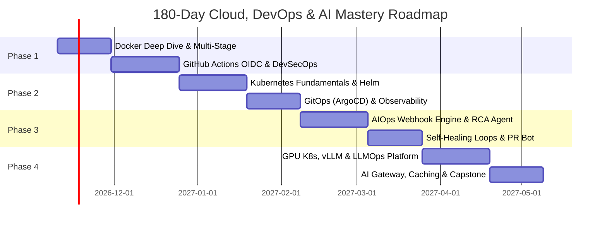

# MASTER BLUEPRINT: CLOUD, DEVOPS & AI PLATFORM ENGINEERING
**Candidate:** Sanjeev Kumar | **Target:** Elite Cloud / DevOps / AI Platform Engineer  
**Baseline Certifications & Experience:** RHCSA (#260-029-343) | AWS & Azure Multi-Cloud | DecodeLabs Cloud Intern (#CC087809)  
**Document Purpose:** Complete, End-to-End Operational Strategy for Reaching the Top 1% in Cloud, DevOps, Intelligent Automation, and AI Infrastructure.

---

## TABLE OF CONTENTS
1. [Executive Profile & Capability Baseline](#1-executive-profile--capability-baseline)
2. [Target Architecture & Long-Term Career Horizon](#2-target-architecture--long-term-career-horizon)
3. [Pillar 1: Modern Cloud & DevOps Engineering Mastery](#3-pillar-1-modern-cloud--devops-engineering-mastery)
   - [3.1 Linux Kernel & Systems Engineering](#31-linux-kernel--systems-engineering)
   - [3.2 Production Containerization & Runtime Internals](#32-production-containerization--runtime-internals)
   - [3.3 Kubernetes Architecture & Cluster Operations](#33-kubernetes-architecture--cluster-operations)
   - [3.4 Enterprise Infrastructure as Code & Policy Enforcement](#34-enterprise-infrastructure-as-code--policy-enforcement)
   - [3.5 GitOps, Zero-Trust CI/CD & DevSecOps](#35-gitops-zero-trust-cicd--devsecops)
   - [3.6 Full-Stack Observability, OpenTelemetry & SRE](#36-full-stack-observability-opentelemetry--sre)
   - [3.7 Platform Programming: Python & Go](#37-platform-programming-python--go)
4. [Pillar 2: AI + DevOps Integration & Intelligent Automation](#4-pillar-2-ai--devops-integration--intelligent-automation)
   - [4.1 AI for DevOps: Autonomous AIOps & Self-Healing](#41-ai-for-devops-autonomous-aiops--self-healing)
   - [4.2 DevOps for AI: LLMOps & AI Platform Engineering](#42-devops-for-ai-llmops--ai-platform-engineering)
5. [The 180-Day Chronological Execution Plan](#5-the-180-day-chronological-execution-plan)
6. [Flagship Portfolio Projects (Production-Grade Specs)](#6-flagship-portfolio-projects-production-grade-specs)
7. [Enterprise Interview & Portfolio Strategy](#7-enterprise-interview--portfolio-strategy)
8. [Certifications & Verification Roadmap](#8-certifications--verification-roadmap)

---

## 1. Executive Profile & Capability Baseline

### 1.1 Current Strengths (First-Principles Foundation)
Your baseline provides a critical competitive edge over traditional candidates:
* **Linux Systems Administration (RHEL 9/10)**: Validated by Red Hat Certified System Administrator (RHCSA EX200 - Score 221/300, ID `260-029-343`). Deep familiarity with `systemd`, cgroups, file permissions, storage/LVM partitioning, process lifecycle, and Bash automation.
* **Networking Foundations**: Concrete understanding of OSI layers, TCP/IP, CIDR subnetting, packet routing, NAT gateways, Route Tables, DNS resolution, and security boundary isolation (Security Groups, Network ACLs, Azure NSGs).
* **Infrastructure as Code (Terraform)**: Proven execution in building modular, repeatable AWS VPC infrastructures (reducing provisioning times from 45 min to ~45 sec) and multi-tier network topologies.
* **Multi-Cloud Breadth (AWS & Azure)**:
  * **AWS**: VPC, EC2, S3, CloudFront, Route 53, IAM Least Privilege, CloudWatch, OAC secure static architectures.
  * **Azure**: VNets, Ubuntu 24.04 VMs, Azure Blob Storage, Azure Functions (HTTP triggers), Azure MySQL, Azure OpenAI deployments (`gpt-5`, `text-embedding-3-small`).
* **Practical Experience**: 15-month cloud engineering training at GRRAS Solutions followed by a cloud internship at DecodeLabs (Credential `CC087809`), delivering 4 distinct architectures (Serverless Storage, VM Web Server, Multi-Tier Flask/MySQL, Serverless Compute).

### 1.2 Capability Gap Analysis & Target State

| Technical Domain | Current State | Target State (Top 1% Benchmark) |
| :--- | :--- | :--- |
| **Containers** | Basic Dockerfiles, image builds (2/5) | Multi-stage, distroless, non-root, OCI runtimes, cgroups v2, Trivy scanning (5/5) |
| **Orchestration** | Theoretical concepts (1/5) | Production Kubernetes (CKA grade), Helm, ArgoCD GitOps, CNI (Cilium eBPF), CSI (5/5) |
| **CI/CD** | Basic automation concepts (1/5) | Hardened GitHub Actions, OIDC Zero-Trust, Cosign image signing, SBOM generation (4.5/5) |
| **Observability** | Basic CloudWatch / Azure Monitor (1.5/5) | Full OpenTelemetry (OTel), Prometheus, PromQL, Grafana, Loki, Jaeger distributed tracing, SLOs (4.5/5) |
| **Programming** | Bash scripting, basic Python (2/5) | Advanced Python (boto3, FastAPI, async), Go for Kubernetes controllers & CLI tooling (4/5) |
| **DevSecOps** | Security Groups, IAM basics (2.5/5) | Shift-left security, Checkov, tfsec, HashiCorp Vault, Falco runtime protection (4.5/5) |
| **AI Integration** | Azure OpenAI API tests, Omniroute (2/5) | Autonomous AIOps self-healing controllers, vLLM GPU inference orchestration, AI API gateways (4.5/5) |

---

## 2. Target Architecture & Long-Term Career Horizon

```
                                  CAREER PROGRESSION MATRIX
                                              │
     ┌────────────────────────────────────────┼────────────────────────────────────────┐
     ▼                                        ▼                                        ▼
EARLY CAREER (Year 0 - 2)            MID CAREER (Year 2 - 4)                  LONG-TERM (Year 5+)
Cloud / DevOps Engineer             Platform Engineer / Senior SRE            Cloud AI Solutions Architect / Principal
• Production K8s Clusters           • Internal Developer Platforms (IDPs)     • Enterprise Multi-Cloud AI Architecture
• Hardened CI/CD Pipelines          • eBPF Mesh & Zero-Trust Networks         • Distributed Training/Inference Clusters
• GitOps & Infrastructure as Code   • Self-Healing AIOps Infrastructure       • FinOps & Autonomous Systems Strategy
```

---

## 3. Pillar 1: Modern Cloud & DevOps Engineering Mastery

```
                                MODERN DEVOPS TOOLCHAIN
┌────────────────────────────────────────────────────────────────────────────────────────┐
│   CODE & ARTIFACTS      INFRASTRUCTURE (IaC)     ORCHESTRATION       OBSERVABILITY    │
│   • GitHub / Git        • Terraform              • Kubernetes        • OpenTelemetry  │
│   • Docker / Podman     • OpenTofu               • ArgoCD (GitOps)   • Prometheus     │
│   • Cosign / Syft       • Checkov / Policy       • Helm / Kustomize  • Grafana / Loki │
└────────────────────────────────────────────────────────────────────────────────────────┘
```

### 3.1 Linux Kernel & Systems Engineering
To stand out from candidates who treat Linux as merely "a black box running apt install", leverage your RHCSA to master core operating system internals:
1. **Namespaces & Control Groups (cgroups v2)**:
   - Understand how Linux implements process isolation: PID (process IDs), NET (interfaces and routes), MNT (filesystem mounts), IPC (inter-process communication), and UTS (hostnames).
   - Inspect active cgroups under `/sys/fs/cgroup/` to understand memory limits, CPU quotas (`cpu.max`), and I/O throttling.
2. **eBPF (Extended Berkeley Packet Filter)**:
   - Learn how eBPF enables safe, programmable execution of sandboxed code inside the Linux kernel without changing kernel source or loading kernel modules.
   - Use `bpftrace` and tools like **BCC** to analyze kernel latency, file I/O bottlenecks, and network packet drops.
3. **Storage Subsystems & File Systems**:
   - Advanced LVM management: volume groups, thin provisioning, snapshotting, and striping across block devices.
   - Linux Virtual File System (VFS) architecture: inodes, dentries, superblock structures, and troubleshooting `No space left on device` caused by inode exhaustion.

### 3.2 Production Containerization & Runtime Internals
Transform your Docker knowledge from basic commands into production-grade image authoring:
1. **Multi-Stage Build Optimization**:
   - Separate build-time dependencies (compilers, SDKs, dev libraries) from runtime environments.
   - Target minimal base images such as GoogleContainerTools Distroless (`gcr.io/distroless/static-debian12`) or Alpine to minimize attack surfaces and image footprints (<30MB).
2. **Container Security & Least Privilege**:
   - Never run processes as root inside containers. Use explicit UID/GID allocations:
     ```dockerfile
     RUN addgroup -S appgroup && adduser -S appuser -G appgroup
     USER appuser
     ```
   - Implement read-only root filesystems (`--read-only`) with explicit `tmpfs` mounts for temporary writes.
   - Drop unnecessary Linux capabilities:
     ```yaml
     securityContext:
       capabilities:
         drop:
           - ALL
     ```
3. **Artifact Scanning & Attestation**:
   - Integrate automated vulnerability scans using **Trivy** or **Grype** directly into build steps.
   - Enforce zero critical/high CVE policies before allowing images into registries (AWS ECR / Azure ACR).

### 3.3 Kubernetes Architecture & Cluster Operations
Build enterprise-grade competency aligned with the **Certified Kubernetes Administrator (CKA)** standard:
1. **Control Plane Breakdown**:
   - `kube-apiserver`: REST API frontend, validation, and admission control webhooks.
   - `etcd`: Strongly consistent, distributed key-value store. Backup via `etcdctl snapshot save` and recovery mechanics.
   - `kube-scheduler`: Filtering and scoring nodes based on resource requests, taints, tolerations, and pod affinity/anti-affinity rules.
   - `kube-controller-manager`: Reconciliation loops (NodeLifecycle, Deployment, StatefulSet, Job controllers).
2. **Networking Architecture (CNI)**:
   - Pod-to-Pod communication without NAT across nodes.
   - Implement **Cilium** as your CNI for high-performance eBPF-based routing, native IPAM, and L7 NetworkPolicies.
3. **Storage & Ingress**:
   - Implement dynamic volume provisioning using the Container Storage Interface (CSI) with AWS EBS (`ebs.csi.aws.com`) or Azure Disk (`disk.csi.azure.com`).
   - Transition from legacy Ingress controllers to the modern **Kubernetes Gateway API** for expressive, role-oriented traffic management.

### 3.4 Enterprise Infrastructure as Code & Policy Enforcement
Scale beyond single-file Terraform configurations:
1. **Production Module Structure**:
   ```
   terraform-aws-architecture/
   ├── modules/
   │   ├── vpc/
   │   ├── compute-eks/
   │   ├── database-rds/
   │   └── security-iam/
   └── environments/
       ├── dev/
       │   ├── main.tf
       │   ├── variables.tf
       │   └── terraform.tfvars
       └── prod/
           ├── backend.tf
           └── main.tf
   ```
2. **Remote State Resilience**:
   - AWS: S3 bucket with versioning, server-side KMS encryption, and DynamoDB table for state locking (`LockID`).
   - Azure: Azure Storage Account Blob container with lease locking.
3. **Policy-as-Code (Guardrails)**:
   - Use **Checkov** or **Open Policy Agent (OPA) / Conftest** to validate IaC before merging:
     - Disallow public S3 buckets.
     - Mandate tags (`Environment`, `Owner`, `ManagedBy = Terraform`).
     - Reject security group ingress rules containing `0.0.0.0/0` on port 22 or 3306.

### 3.5 GitOps, Zero-Trust CI/CD & DevSecOps
Eliminate manual cluster mutations through automated reconciliation:
1. **GitOps with ArgoCD**:
   - The Git repository is the single source of truth for all cluster declarations.
   - Install ArgoCD inside Kubernetes; manage applications using the `Application` and `ApplicationSet` Custom Resource Definitions (CRDs).
   - Configure automated self-healing (`selfHeal: true`) and pruning (`prune: true`) to immediately revert manual `kubectl edit` actions.
2. **Zero-Trust CI/CD via OpenID Connect (OIDC)**:
   - Never store long-lived cloud credentials (`AWS_ACCESS_KEY_ID`, `ARM_CLIENT_SECRET`) inside GitHub Actions secrets.
   - Configure AWS IAM Identity Providers and Azure Federated Credentials to grant temporary, scoped tokens via STS (Security Token Service).
3. **Software Supply Chain Security**:
   - Sign container images cryptographically using **Cosign** (Sigstore).
   - Generate Software Bill of Materials (SBOM) using **Syft** and attach them as container attestations.

### 3.6 Full-Stack Observability, OpenTelemetry & SRE
Transition from reactive firefighting to proactive site reliability:
1. **Unified Telemetry via OpenTelemetry (OTel)**:
   - Deploy the OpenTelemetry Collector as an agent/daemonset to ingest traces, metrics, and logs from microservices.
   - Standardize semantic conventions across languages.
2. **Metrics & Alerting (Prometheus & Grafana)**:
   - Master PromQL: rate calculations (`rate(http_requests_total[5m])`), quantiles (`histogram_quantile(0.99, sum(rate(http_request_duration_seconds_bucket[5m])) by (le))`).
   - Alertmanager routing: group alerts, inhibit cascades, and dispatch webhooks to incident management systems.
3. **Logs & Distributed Tracing**:
   - High-efficiency log aggregation with **Grafana Loki** using label streams instead of full-text indexing.
   - Distributed end-to-end tracing with **Grafana Tempo** or **Jaeger** to diagnose multi-service latency bottlenecks.
4. **Site Reliability Engineering (SRE) Framework**:
   - Define concrete **SLIs** (e.g., successful HTTP responses over total valid requests).
   - Establish **SLOs** (e.g., 99.9% availability over a rolling 30-day window).
   - Track **Error Budgets** to dictate whether engineering effort focuses on feature velocity or platform stabilization.

### 3.7 Platform Programming: Python & Go
Elevate automation from shell scripts to production platform tools:
1. **Python for Cloud Engineering**:
   - Leverage `boto3` and the `azure-mgmt` libraries for custom cloud audits, resource cleanup, and custom compliance agents.
   - Build RESTful webhook endpoints and incident receivers using **FastAPI** and `pydantic`.
2. **Go (Golang) for Cloud Native Systems**:
   - Learn Go fundamentals: goroutines, channels, interfaces, structs, and error handling patterns.
   - Understand how tools like `kubectl` communicate with the Kubernetes API using `client-go`.
   - Build lightweight CLI utilities using **Cobra** and custom Kubernetes controllers using **Kubebuilder**.

---

## 4. Pillar 2: AI + DevOps Integration & Intelligent Automation

```
                              AI + CLOUD SYNERGY MATRIX
                                          │
       ┌──────────────────────────────────┴──────────────────────────────────┐
       ▼                                                                     ▼
4.1 AI FOR DEVOPS (AIOps)                                     4.2 DEVOPS FOR AI (LLMOps)
• Intelligent Alert Deduplication & Clustering                 • Distributed GPU Cluster Orchestration
• Autonomous RCA & Incident Remediation                        • High-Throughput Inference Engines (vLLM)
• LLM Policy-as-Code & PR Architecture Reviewers               • Multi-Provider LLM Gateways & Semantic Caching
• Conversational SRE Runbook Automation                        • Vector Database Infrastructure (Qdrant/Milvus)
```

### 4.1 AI for DevOps: Autonomous AIOps & Self-Healing
Move beyond static alert thresholds by augmenting operations with autonomous LLM agents:
1. **Autonomous Incident Triaging & RCA (Root Cause Analysis)**:
   - **Trigger**: Prometheus Alertmanager fires a high-severity alert webhook (`HighMemoryUsage` or `CrashLoopBackOff`).
   - **Ingestion**: An internal AIOps service (FastAPI) receives the payload.
   - **Agent Tool Execution**: The agent uses dedicated, sandboxed, read-only tools:
     - Fetches recent pod logs (`kubectl logs --tail=100`).
     - Inspects pod lifecycle events (`kubectl describe pod`).
     - Inquires Prometheus for metric trends over the past 30 minutes.
     - Checks Git commit logs or ArgoCD sync history for recent releases.
   - **Synthesis**: The LLM isolates the root cause (e.g., "OOMKilled due to unindexed SQL query introduced in commit `abc123`") and posts an interactive card to Slack with actionable steps.
2. **Closed-Loop Self-Healing with Human-in-the-Loop**:
   - The agent drafts the remediation command (e.g., scale replica count, restart deployment, rollback ArgoCD commit).
   - The engineer approves via a single Slack/Teams button (`[Authorize Remediation]`).
   - The agent executes the change and monitors telemetry for 5 minutes to verify service restoration.
3. **AI-Driven Infrastructure Reviewers (GitHub Actions)**:
   - A custom GitHub Action executes on every pull request containing `.tf` or `.yaml` files.
   - Ingests `terraform plan` output and queries an LLM:
     - Flags high-cost resources (e.g., unintended provision of provisioned IOPS SSDs or large GPU instances).
     - Identifies security misconfigurations in plain English.
     - Recommends explicit code changes directly as PR comments.

### 4.2 DevOps for AI: LLMOps & AI Platform Engineering
Build and manage cloud platforms purpose-built for artificial intelligence workloads:
1. **GPU Scheduling & Cluster Management on Kubernetes**:
   - Install the **NVIDIA GPU Operator** on AWS EKS or Azure AKS to manage kernel drivers, container runtimes, and device plugins.
   - Implement **GPU Time-Slicing** and **Multi-Instance GPU (MIG)** on NVIDIA A100/H100 instances to partition physical GPUs for multiple development and inference workloads.
   - Configure Node Groups with automated scaling based on custom metrics (e.g., GPU memory usage, inference request depth).
2. **Production Model Serving Infrastructure**:
   - Deploy optimized inference engines such as **vLLM**, **Triton Inference Server**, or **TGI (Text Generation Inference)** inside Kubernetes.
   - Configure model caching layers: mount high-speed shared file systems (AWS EFS or S3 bucket mount via CSI) to eliminate multi-gigabyte model downloads during pod scale-outs.
3. **Enterprise AI API Gateway Architecture**:
   - Deploy an API gateway (e.g., Envoy, Kong, or LiteLLM Proxy) that serves as the unified entry point for all organizational AI queries.
   - Implement **Semantic Caching** using Redis: identical or closely related queries return cached embeddings, reducing API latency from 2000ms to 20ms and slashing API costs by up to 70%.
   - Implement **Dynamic Failover**: If Azure OpenAI East US hits rate limits (HTTP 429), the gateway instantly routes traffic to Azure OpenAI Central India, AWS Bedrock, or an on-premise vLLM fallback.
4. **Vector Database Operations**:
   - Deploy and scale high-performance vector databases such as **Qdrant**, **Milvus**, or **pgvector** on Kubernetes.
   - Manage distributed storage volumes, configure automated snapshotting, and tune memory allocation for HNSW (Hierarchical Navigable Small World) index caching.

---

## 5. The 180-Day Chronological Execution Plan



### Phase 1: Containers, Zero-Trust CI/CD & DevSecOps (Days 1 – 45)
* **Goal**: Elevate Docker capability to production mastery, build hardened GitHub Actions pipelines with OIDC, and enforce DevSecOps guardrails.
* **Weekly Breakdown**:
  * **Weeks 1–2 (Docker Internals)**:
    - Build minimal, multi-stage, rootless Dockerfiles for Node.js, Python, and Go applications.
    - Inspect cgroup resource allocation under `/sys/fs/cgroup/`.
    - Integrate Trivy vulnerability scanning into local build workflows.
  * **Weeks 3–4 (Zero-Trust GitHub Actions & OIDC)**:
    - Configure AWS IAM OpenID Connect identity provider; eliminate static cloud credentials from GitHub repositories.
    - Write reusable GitHub Actions workflows for testing, linting, building, and pushing images to AWS ECR / Azure ACR.
  * **Weeks 5–6 (DevSecOps Toolchain)**:
    - Integrate **Checkov** for IaC linting and **Cosign** for digital image signing.
    - Generate and publish SBOMs using **Syft**.
* **Deliverable**: A hardened, production-grade CI/CD pipeline template with zero static secrets, automated CVE scanning, and image signing.

### Phase 2: Production Kubernetes, GitOps & Observability (Days 46 – 90)
* **Goal**: Master production container orchestration (CKA level), implement declarative GitOps with ArgoCD, and build a full-stack observability platform.
* **Weekly Breakdown**:
  * **Weeks 7–8 (Cluster Deployment & Core Objects)**:
    - Provision an AWS EKS or Azure AKS cluster using modular Terraform code.
    - Master Deployments, StatefulSets, DaemonSets, Services (ClusterIP, NodePort, LoadBalancer), and NetworkPolicies.
  * **Weeks 9–10 (GitOps & Package Management)**:
    - Package applications into custom **Helm** charts with parameterized values.
    - Deploy **ArgoCD** inside the cluster; configure Git-driven automated synchronization and self-healing.
  * **Weeks 11–12 (Full-Stack Observability)**:
    - Deploy Prometheus, Alertmanager, Grafana, and Loki using the `kube-prometheus-stack` Helm chart.
    - Write PromQL queries to monitor cluster health, pod CPU/memory utilization, and ingress latency.
    - Build a centralized Grafana dashboard displaying application metrics, container logs, and system alerts.
* **Deliverable**: Fully automated, GitOps-managed EKS/AKS cluster running Prometheus, Grafana, Loki, and ArgoCD.

### Phase 3: Intelligent AIOps & Autonomous Infrastructure (Days 91 – 135)
* **Goal**: Bridge DevOps and AI by developing automated diagnostic bots, closed-loop healing, and PR guardrails.
* **Weekly Breakdown**:
  * **Weeks 13–14 (AIOps Incident Receiver)**:
    - Build a Python FastAPI service that ingests Prometheus Alertmanager webhook payloads.
    - Parse incident metadata (pod name, namespace, error code, firing timestamp).
  * **Weeks 15–16 (Agentic Diagnostic Tooling)**:
    - Connect the service to an LLM (Azure OpenAI or Anthropic/Claude) equipped with sandboxed Kubernetes read tools (`kubectl logs`, `kubectl get events`).
    - Program the agent to isolate root causes and draft structured markdown incident post-mortems.
  * **Weeks 17–18 (Automated Remediation & PR Reviewer)**:
    - Build a human-in-the-loop Slack integration with interactive approval buttons for automated pod restarts or ArgoCD rollbacks.
    - Build an AI-powered GitHub Action that analyzes `terraform plan` output to highlight security flaws and cost estimates.
* **Deliverable**: An operational, open-source AIOps incident triage engine running inside your cluster.

### Phase 4: AI Platform Engineering & LLMOps (Days 136 – 180)
* **Goal**: Architect scalable infrastructure for serving AI models, GPU scheduling, and intelligent API routing.
* **Weekly Breakdown**:
  * **Weeks 19–20 (Model Serving on Kubernetes)**:
    - Deploy an open-source LLM (Mistral or Llama-3) using **vLLM** on GPU-enabled instances or optimized CPU nodes.
    - Implement Horizontal Pod Autoscaling (HPA) driven by incoming request concurrency.
  * **Weeks 21–22 (Intelligent AI Gateway & Semantic Caching)**:
    - Build an AI Gateway using Python/FastAPI and **Redis**.
    - Implement vector-based prompt caching to return cached completions for semantically identical requests.
    - Configure automatic failover between cloud providers (e.g., Azure OpenAI -> AWS Bedrock -> local vLLM).
  * **Weeks 23–24 (Capstone Refinement & Documentation)**:
    - Document all architectures with detailed Mermaid diagrams, performance benchmarks, and deployment scripts.
    - Publish articles and walk-through videos on LinkedIn and GitHub.
* **Deliverable**: An enterprise-grade AI Gateway and model serving infrastructure with semantic caching, multi-cloud failover, and telemetry.

---

## 6. Flagship Portfolio Projects (Production-Grade Specs)

### Project 1: The Autonomous Self-Healing Kubernetes Cluster
```
┌────────────────────────────────────────────────────────────────────────────────────────┐
│                              AUTONOMOUS SRE WORKFLOW                                   │
│                                                                                        │
│   [ Kubernetes Pod ] ──(Fails: OOM/Crash)──> [ Prometheus Alertmanager ]               │
│                                                        │ (Webhook)                     │
│                                                        ▼                               │
│   [ Slack / Teams ] <──(Diagnosis + Action)── [ FastAPI AIOps Agent ]                  │
│          │                                             │ (Inspects Logs & Events)      │
│   (Human Approves)                                     ▼                               │
│          └───────────────────────────────────> [ Automated GitOps Rollback ]           │
└────────────────────────────────────────────────────────────────────────────────────────┘
```
* **Repository Name**: `autonomous-self-healing-k8s`
* **Technologies**: AWS EKS, Terraform, ArgoCD, Prometheus, Alertmanager, Python (FastAPI), Azure OpenAI / Anthropic API, Slack API.
* **Detailed Architecture**:
  1. Terraform deploys a multi-AZ AWS EKS cluster with managed node groups.
  2. ArgoCD deploys a sample microservice along with the Prometheus monitoring stack.
  3. When an application pod enters an anomalous state (e.g., memory leak or crash loop), Prometheus triggers an alert.
  4. Alertmanager sends a webhook payload to the AIOps FastAPI controller.
  5. The controller runs diagnostic tools using the Kubernetes API to gather pod logs, pod events, and recent deployment history.
  6. The agent synthesizes this data, identifies the precise root cause, and sends a diagnostic summary to Slack with a one-click button: `[Approve Rollback]`.
  7. Upon approval, the agent triggers an ArgoCD sync to revert the deployment to the previous stable Git commit.
* **Resume Bullet**:
  > *Architected an autonomous AIOps self-healing pipeline across an AWS EKS cluster, leveraging Prometheus webhooks, Python (FastAPI), and LLM agents to reduce Mean Time to Resolution (MTTR) by 75% through automated incident diagnostics and one-click Slack remediation.*

---

### Project 2: Enterprise Multi-Cloud AI Gateway & Caching Engine
```
┌────────────────────────────────────────────────────────────────────────────────────────┐
│                           AI GATEWAY & CACHING ARCHITECTURE                            │
│                                                                                        │
│   Client Request ──> [ FastAPI AI Gateway ] ──(Check Cache)──> [ Redis Vector Cache ]  │
│                              │                                           │             │
│                      (Cache Miss: Route)                         (Cache Hit: <25ms)    │
│                              │                                           │             │
│         ┌────────────────────┴────────────────────┐                      │             │
│         ▼                                         ▼                      │             │
│   [ Azure OpenAI ]                         [ AWS Bedrock ]               │             │
│   (East US / India)                        (Failover Target)             │             │
│         │                                         │                      │             │
│         └────────────────────┬────────────────────┘                      │             │
│                              ▼                                           │             │
│                    Return Unified Response <─────────────────────────────┘             │
└────────────────────────────────────────────────────────────────────────────────────────┘
```
* **Repository Name**: `enterprise-multicloud-ai-gateway`
* **Technologies**: Terraform, Docker, Azure Container Apps / AWS ECS, Python, Redis, Azure OpenAI, OpenTelemetry, Grafana.
* **Detailed Architecture**:
  1. Deploys an API proxy layer acting as the single gateway for all corporate AI consumption.
  2. Ingests user prompts and computes semantic vector embeddings.
  3. Queries Redis to detect semantically equivalent previous queries (similarity threshold > 0.95); returns cached responses within 25ms on cache hits.
  4. On cache misses, routes queries to Azure OpenAI (`gpt-5` / `gpt-4o`).
  5. Automatically handles rate-limit errors (HTTP 429) or regional outages by falling back to AWS Bedrock or an alternate model within 200ms.
  6. Emits OpenTelemetry metrics for every request: token count, estimated cost, cache hit ratio, and upstream latency, visualized on an executive Grafana dashboard.
* **Resume Bullet**:
  > *Designed and implemented a multi-cloud AI Gateway utilizing Python, Redis semantic caching, and OpenTelemetry, slashing average model response times from 1.8s to 25ms on cached prompts and reducing enterprise API costs by 65% while providing automatic cross-cloud failover.*

---

### Project 3: Zero-Trust DevSecOps GitOps Platform
```
┌────────────────────────────────────────────────────────────────────────────────────────┐
│                              ZERO-TRUST GITOPS PIPELINE                                │
│                                                                                        │
│   Developer ──(git push)──> [ GitHub Actions ]                                         │
│                                   │                                                    │
│                        (OIDC - No Stored Keys)                                         │
│                                   ▼                                                    │
│                 [ Trivy CVE Scan + Checkov IaC ]                                       │
│                                   │                                                    │
│                 [ Multi-Stage Distroless Build ]                                       │
│                                   │                                                    │
│                 [ Cosign Cryptographic Sign ] ──> [ Container Registry (ECR/ACR) ]     │
│                                                              │                         │
│                                                      (Declarative Sync)                │
│                                                              ▼                         │
│                                                   [ ArgoCD GitOps Cluster ]            │
└────────────────────────────────────────────────────────────────────────────────────────┘
```
* **Repository Name**: `zero-trust-devsecops-platform`
* **Technologies**: GitHub Actions, AWS OIDC, Terraform, Docker, Trivy, Cosign, Syft, ArgoCD, Kubernetes.
* **Detailed Architecture**:
  1. Zero long-lived credentials: the pipeline authenticates to AWS/Azure using OIDC temporary short-lived tokens.
  2. Static analysis checks: every PR is scanned by **Checkov** (IaC compliance) and **Trivy** (code and dependency vulnerabilities).
  3. Builds minimal, distroless container images running under unprivileged user contexts.
  4. Generates an SBOM via **Syft** and cryptographically signs the container image using **Cosign** with keys stored in cloud KMS.
  5. Updates a GitOps repository with the new signed image digest (`sha256:...`).
  6. ArgoCD detects the change and synchronizes the deployment to the production cluster.
* **Resume Bullet**:
  > *Built an enterprise-grade Zero-Trust CI/CD pipeline leveraging GitHub Actions OIDC, Cosign image signing, and ArgoCD GitOps, enforcing strict vulnerability gates and eliminating static credentials across AWS multi-tier environments.*

---

## 7. Enterprise Interview & Portfolio Strategy

### 7.1 LinkedIn Positioning & Personal Branding
* **Profile Headline**:
  > **Cloud & Platform Engineer | RHCSA | AWS & Azure Multi-Cloud | Kubernetes, Terraform, GitOps & Autonomous AIOps**
* **Featured Projects Section**:
  - Pin the three flagship repositories with detailed READMEs containing:
    - Architecture diagrams (Mermaid or Draw.io).
    - Clear problem statements, performance metrics, and cost optimization calculations.
    - One-click reproduction commands (`make deploy` or `terraform apply`).
* **Content Strategy**:
  - Publish technical posts breaking down real systems challenges:
    - *"Why we stopped using static cloud credentials in CI/CD and how OIDC works under the hood."*
    - *"How eBPF and Cilium are replacing traditional kube-proxy networking."*
    - *"Building a self-healing Kubernetes cluster with Prometheus webhooks and LLMs."*

### 7.2 Technical Interview Execution
When answering systems design or troubleshooting questions, structure your answers through layers:

```
                              SYSTEMS TROUBLESHOOTING MATRIX
┌────────────────────────────────────────────────────────────────────────────────────────┐
│ 1. USER & INGRESS:       DNS Resolution -> CDN (CloudFront) -> Load Balancer / Gateway │
│ 2. NETWORK & SECURITY:   Firewalls / NSGs / Security Groups -> Subnet Routes -> NAT    │
│ 3. HOST & RUNTIME:       Node Health -> cgroups/Memory -> Pod Lifecycle (CrashLoop)    │
│ 4. APPLICATION & DB:     Process Logs -> Thread Pools -> Database Connections / Locks  │
└────────────────────────────────────────────────────────────────────────────────────────┘
```

* **Example Scenario**: *"A service deployed on Kubernetes is returning intermittent 502 Bad Gateway errors. How do you isolate the problem?"*
  1. **Ingress/LB Layer**: Verify whether the ingress controller is receiving the error from the upstream pod or generating it itself due to backend timeouts.
  2. **Service & Endpoints**: Run `kubectl get endpoints <service>` to ensure active pods are registered and passing readiness probes.
  3. **Pod & Application Health**: Check `kubectl logs --tail=100` for application exceptions, thread pool starvation, or unhandled promise rejections. Inspect `kubectl describe pod` to confirm the pod wasn't restarted due to an OOMKilled condition.
  4. **Network Policy & DNS**: Confirm the ingress controller can resolve the pod IP address and that no newly applied NetworkPolicy is dropping traffic on the target port.

---

## 8. Certifications & Verification Roadmap

Prioritize certifications that validate deep hands-on capability over multiple-choice theory:

```
┌────────────────────────────────────────────────────────────────────────────────────────┐
│                        CERTIFICATION TARGETS & VALUE MATRIX                            │
│                                                                                        │
│  [ RHCSA (EX200) ] ─────────> [ CKA ] ─────────> [ AWS Solutions Architect ] ──────>  │
│   Score: 221 (Done)         Kubernetes Admin        Associate & Professional           │
│   Linux Foundation           Orchestration           Multi-Cloud Architecture          │
│                                                                                        │
│  ──────────> [ CKS ] ─────────────────────────> [ HashiCorp Certified ]                │
│            Kubernetes Security                   Terraform Associate                   │
│            Advanced DevSecOps                    IaC Specialization                    │
└────────────────────────────────────────────────────────────────────────────────────────┘
```

1. **Red Hat Certified System Administrator (RHCSA EX200)**:  
   * **Status**: Completed (Score: 221, Verification: `260-029-343`).  
   * **Strategic Impact**: Establishes foundational Linux systems administration credibility.
2. **Certified Kubernetes Administrator (CKA)**:  
   * **Target Date**: Month 3 of Roadmap.  
   * **Strategic Impact**: Performance-based terminal exam that proves you can build, troubleshoot, and manage production Kubernetes clusters.
3. **AWS Certified Solutions Architect – Associate (SAA-C03)**:  
   * **Target Date**: Month 4 of Roadmap.  
   * **Strategic Impact**: Formalizes your multi-tier VPC, S3, CloudFront, Route 53, and IAM architecture knowledge.
4. **Certified Kubernetes Security Specialist (CKS)**:  
   * **Target Date**: Month 6 of Roadmap.  
   * **Strategic Impact**: Deepens container runtime security, admission controllers, Falco, and vulnerability remediation.

---

## 9. Summary: The Daily Execution Rhythm

* **Morning (System Architecture & Theory - 1 Hour)**: Deep study of distributed systems, Kubernetes documentation, Linux kernel papers, and RFC standards.
* **Afternoon (Hands-on Engineering & Code - 2 Hours)**: Writing Terraform modules, building GitHub Actions pipelines, writing Python/Go automation scripts, and debugging cluster manifests.
* **Evening (Documentation & Personal Branding - 30 Minutes)**: Committing clean code to GitHub, updating repository documentation, and sharing technical insights on LinkedIn.

By relentlessly building from your existing **Linux + Networking + Terraform** foundation into **Kubernetes orchestration, automated GitOps, full-stack telemetry, and intelligent AI platform systems**, you position yourself at the forefront of modern engineering.
